<p align="center">
  
</p>

<h1 align="center">CoffeeCopy</h1>

<p align="center">Um histórico da área de transferência rápido, local e com busca, para Windows.</p>

<p align="center"><a href="README.md">English</a> · <b>Português (Brasil)</b></p>


> O GIF e todos os prints deste README usam **dados fictícios**: itens inventados para a demonstração, não uma área de transferência real.

## Por que isso existe

O histórico de área de transferência nativo do Windows (`Win+V`) é uma porcaria.

Eu preciso usar Windows no trabalho e cansei da bullshit que é a clipboard nativa. Segundo a própria [documentação da Microsoft](https://support.microsoft.com/en-us/windows/apps/using-the-clipboard), ela guarda só os **últimos 25 itens**, **apaga tudo ao reiniciar** (menos os itens fixados), limita cada item a **4 MB** e só aceita texto, HTML e imagens. E não tem busca.

Então usei o [Claude](https://claude.com/claude-code) para fazer algo relativamente melhor. Esse é o CoffeeCopy.

## Prints

| Histórico | Busca fuzzy |
| --- | --- |
| 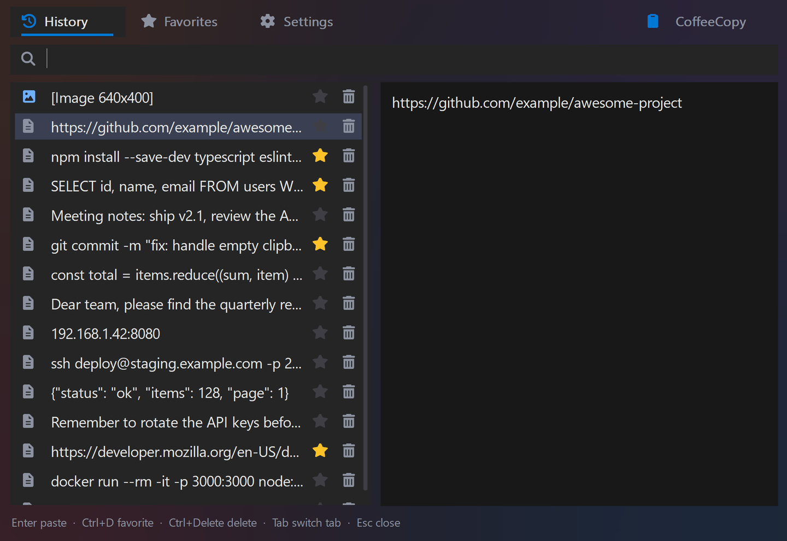 | 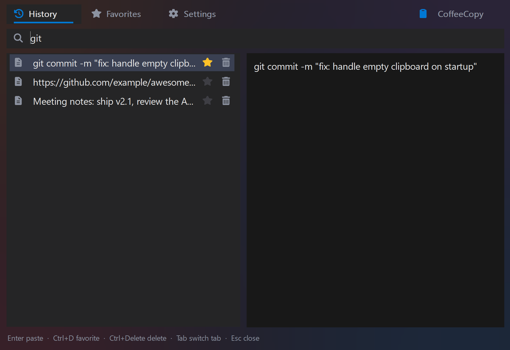 |

| Favoritos | Prévia de imagem |
| --- | --- |
| 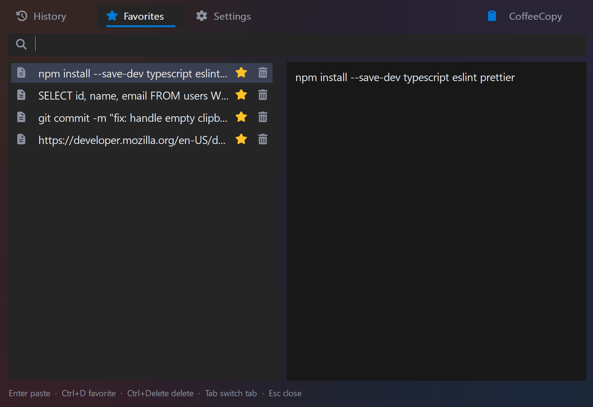 | 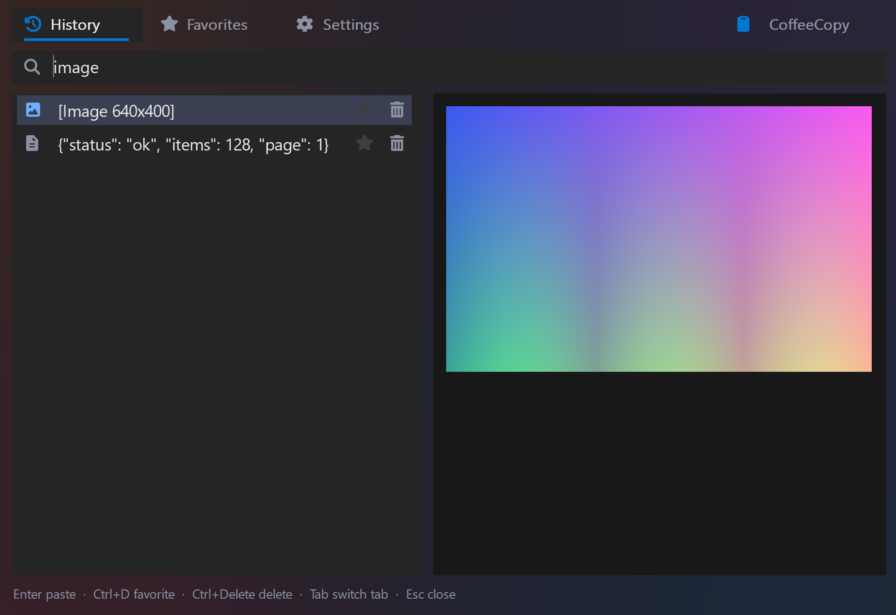 |

| Configurações: aparência | Configurações: sons |
| --- | --- |
| 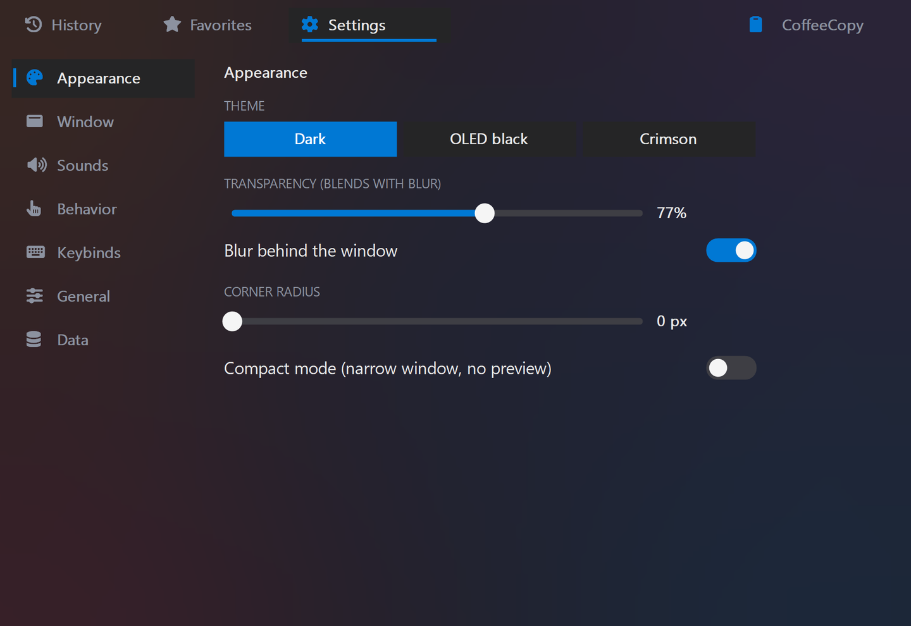 | 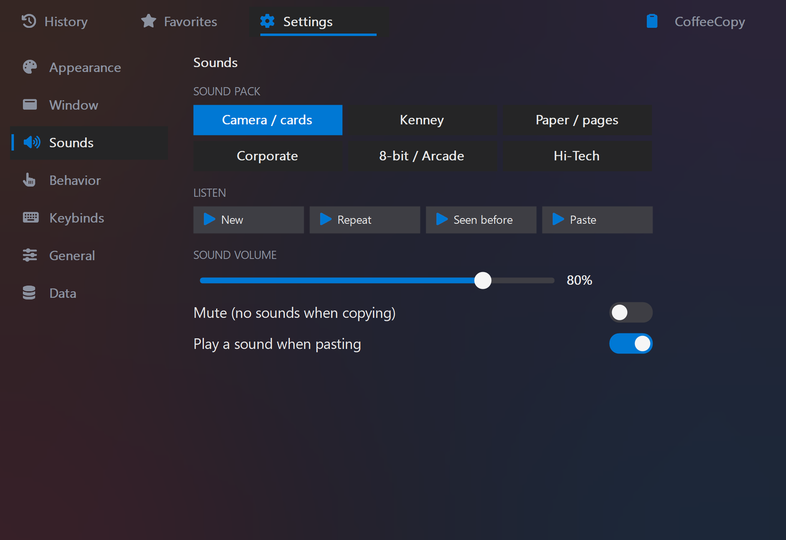 |

| Configurações: teclas | Modo compacto |
| --- | --- |
| 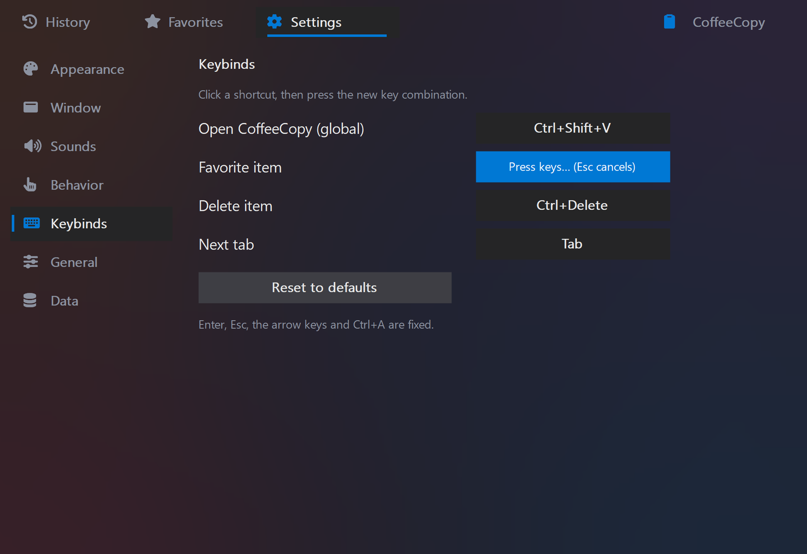 | 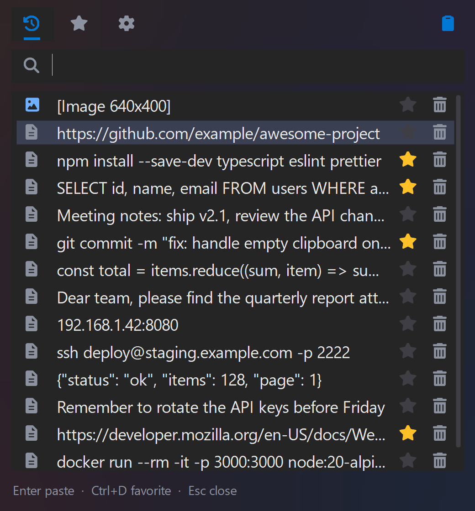 |

| Tema Crimson | Tema OLED preto |
| --- | --- |
| 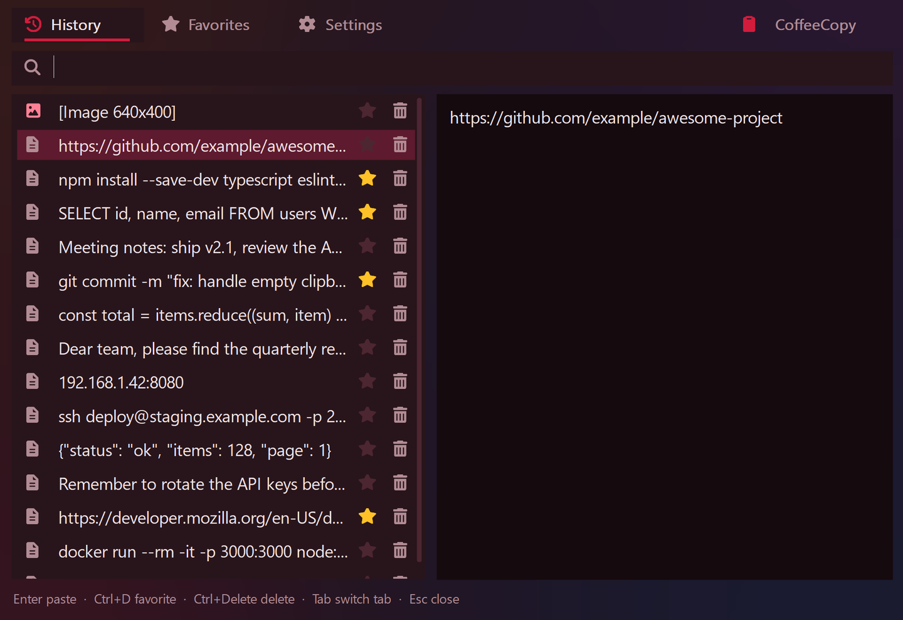 | 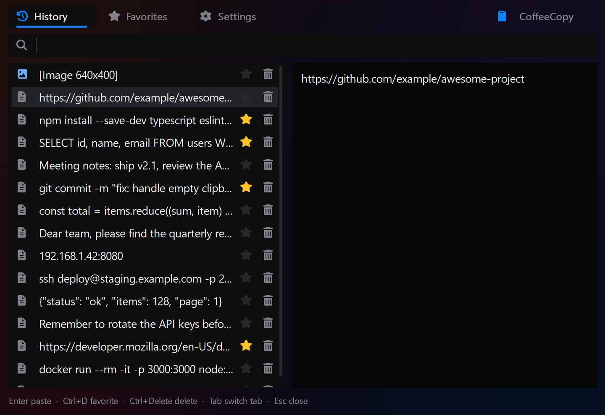 |

| Japonês | Russo | Chinês |
| --- | --- | --- |
| 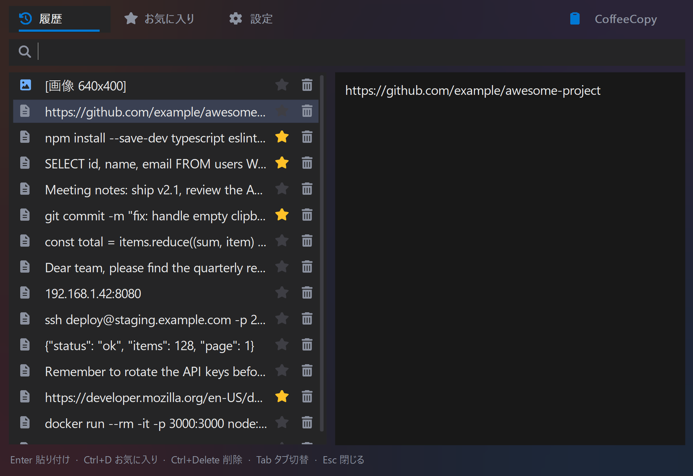 | 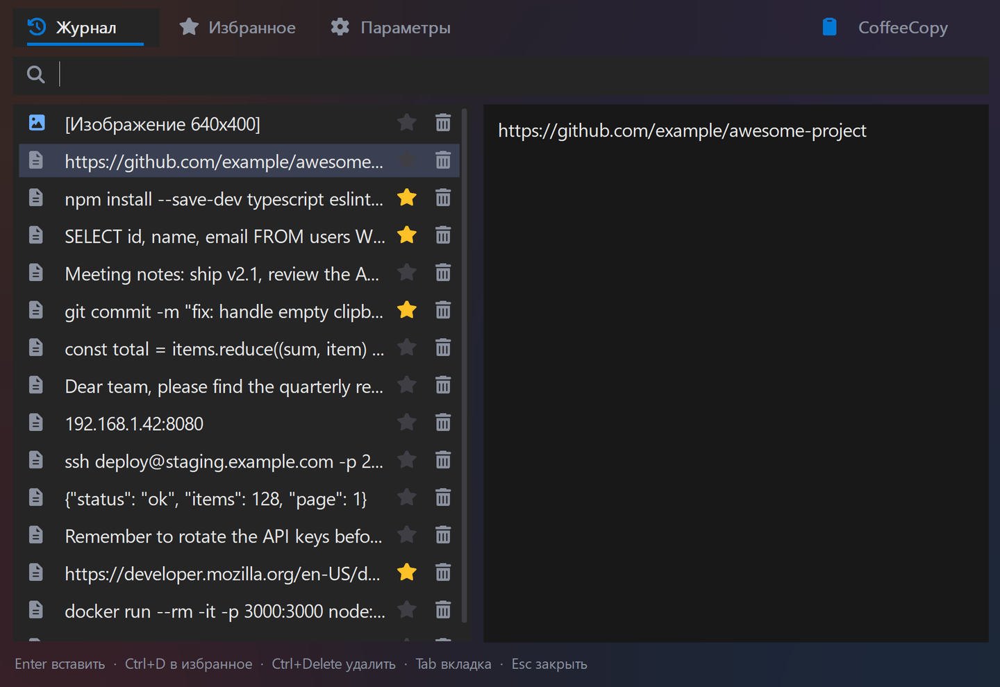 | 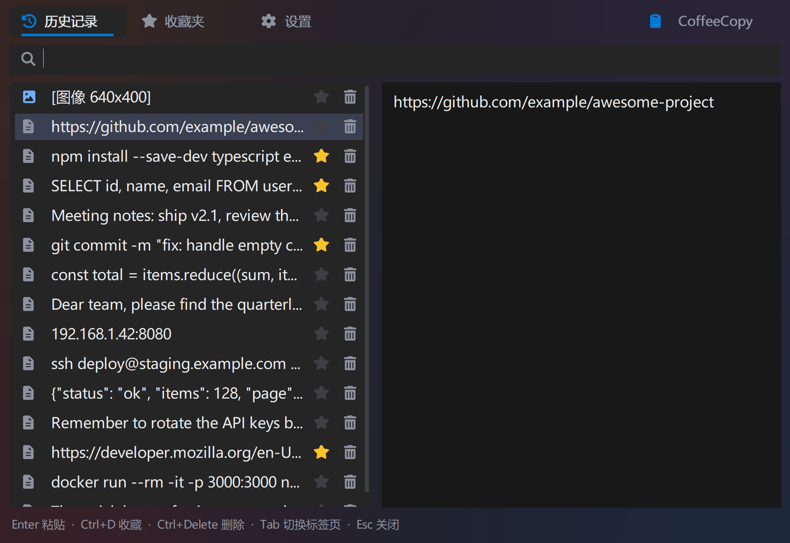 |

## Funções

**Histórico e busca**
- Guarda tudo que você copia (texto e imagens), sem limite fixo de itens (a lista mostra até 5.000 resultados por vez), e mantém depois de reiniciar.
- Busca fuzzy: digite algumas letras, ou várias palavras, e os melhores resultados vêm primeiro.
- Favoritos: marque um item com a estrela e ache numa aba própria. Os favoritos sobrevivem ao "Limpar histórico".
- Painel de prévia para texto e imagens. Apague itens um a um ou limpe o histórico todo.

**Colar**
- Escolha um item com `Enter` ou um clique e ele é colado no app que você estava usando.
- Modo opcional "só copiar": coloca o item na área de transferência e você cola sozinho.
- Confirme com duplo clique (padrão) ou um clique. Passar o mouse sobre um item o seleciona.

**Feedback sonoro**
- Um som diferente para uma cópia *nova*, uma *repetição* do item atual, algo *já copiado antes* e uma *colagem*.
- Seis pacotes de sons (Câmera / cartas, Kenney, Papel / páginas, Corporativo, 8-bit / Arcade, Hi-Tech), controle de volume e botão de silenciar.

**Aparência**
- Três temas (Escuro, OLED preto, Crimson), transparência da janela, efeito de desfoque (blur) e arredondamento dos cantos ajustável.
- Modo compacto: uma janela estreita só com a lista.
- Na primeira execução o app já vem com desfoque ligado, 77% de transparência e cantos retos.
- Animações suaves (fade ou deslizar), nítido em telas de alta resolução, com formas suavizadas.
- Abre onde você quiser: centro da tela, perto do cursor, topo ou canto inferior direito, no monitor que você está usando.

**Teclado**
- Um atalho global para abrir (padrão `Ctrl+Shift+V`).
- Todos os atalhos podem ser remapeados em Configurações → Teclas.
- Opcional: assumir o `Win+V` do Windows e desativar o histórico de área de transferência do Windows.

**Integração com o Windows**
- Ícone na bandeja (se adapta à barra de tarefas clara ou escura), iniciar com o Windows, instalador por usuário com desinstalador.

**Idiomas**
- English (nativo), Português (Brasil), Русский, 中文 e 日本語. Troque em Configurações → Geral.

## Atalhos de teclado

| Ação | Padrão | Remapeável |
| --- | --- | --- |
| Abrir / fechar o CoffeeCopy (global) | `Ctrl+Shift+V` | sim |
| Colar ou copiar o item selecionado | `Enter` | não |
| Favoritar o item selecionado | `Ctrl+D` | sim |
| Apagar o item selecionado | `Ctrl+Delete` | sim |
| Próxima aba (`Shift` + tecla: aba anterior) | `Tab` | sim |
| Mover a seleção | `↑` `↓` `PgUp` `PgDn` | não |
| Fechar | `Esc` | não |
| Selecionar tudo na busca | `Ctrl+A` | não |

## Instalar

1. Baixe o `CoffeeCopy-Setup.exe` (está em [`dist/`](dist/)).
2. Execute. Ele instala para o usuário atual em `%LOCALAPPDATA%\Programs\CoffeeCopy`. Não precisa de administrador.
3. Aperte `Ctrl+Shift+V`.

O instalador não é assinado digitalmente, então o Windows SmartScreen pode avisar na primeira vez: clique em **Mais informações → Executar assim mesmo**.

Instalação silenciosa: `CoffeeCopy-Setup.exe --silent`. Para desinstalar, use Configurações do Windows → Aplicativos, ou rode o `uninstall.exe` na pasta de instalação.

## Compilar do código-fonte

Você precisa de:
- Rust (stable) com o alvo `x86_64-pc-windows-gnu`.
- O `windres` do MinGW no `PATH` (ele embute o ícone; sem ele a compilação funciona, só sem ícone).

```
cargo build --release
```

O instalador embute a versão release, então compile o app primeiro:

```
cd installer
cargo build --release
```

Rode os testes de tradução com `cargo test`.

## Modo demonstração

`coffeecopy.exe --demo <pasta>` preenche uma pasta de dados descartável com itens fictícios, percorre toda a interface e salva prints e quadros de GIF (BMP) em `<pasta>`. Ele nunca mexe no seu histórico, nas suas configurações nem no registro. Foi assim que a mídia deste README foi feita.

Você também pode apontar o app para outra pasta de dados com a variável de ambiente `COFFEECOPY_DATA`.

## Seus dados

Tudo fica na sua máquina, em `%APPDATA%\CoffeeCopy` (histórico, favoritos, configurações, imagens). Nada é enviado para lugar nenhum.

Atenção: o histórico é guardado **sem criptografia**, e uma área de transferência pode conter senhas. Limpe em Configurações → Dados sempre que precisar.

## Créditos

- Os sons são do [OpenGameArt](https://opengameart.org): Kenney, Brandon Morris, PWL, starninjas, Cockatrice, Little Robot e os pacotes 8-bit e Hi-Tech, todos CC0. O som de papel amassando é de Nicole Marie T, [CC BY 4.0](https://creativecommons.org/licenses/by/4.0/).
- Os ícones são do [Font Awesome Free 7](https://fontawesome.com) (CC BY 4.0).
- As traduções da interface seguem a terminologia oficial do Windows da Microsoft (histórico da área de transferência, configurações, colar, excluir) em russo, chinês e japonês.
- Feito com o Claude.
